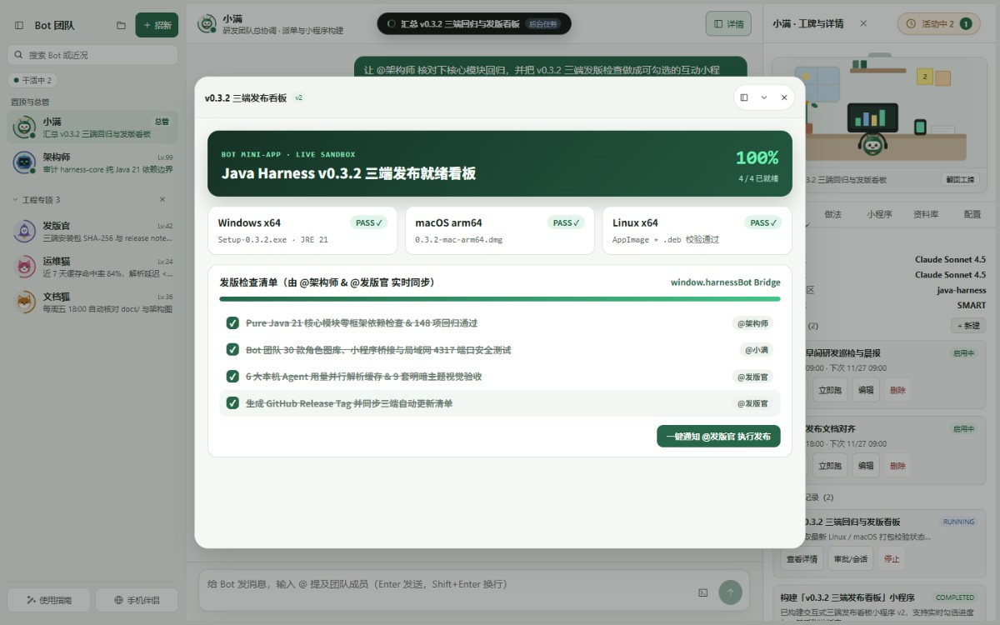
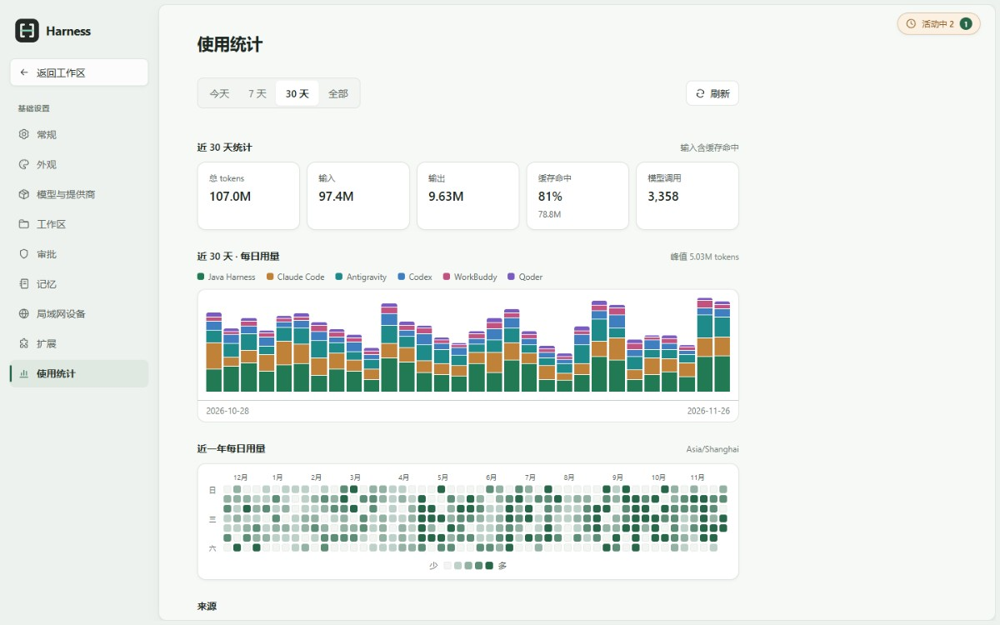
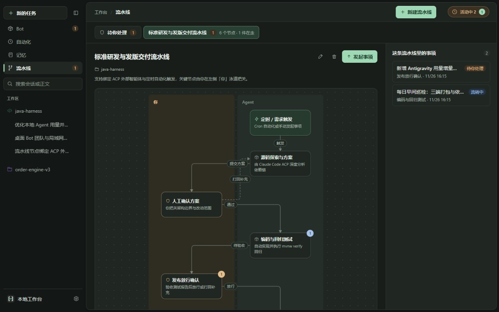
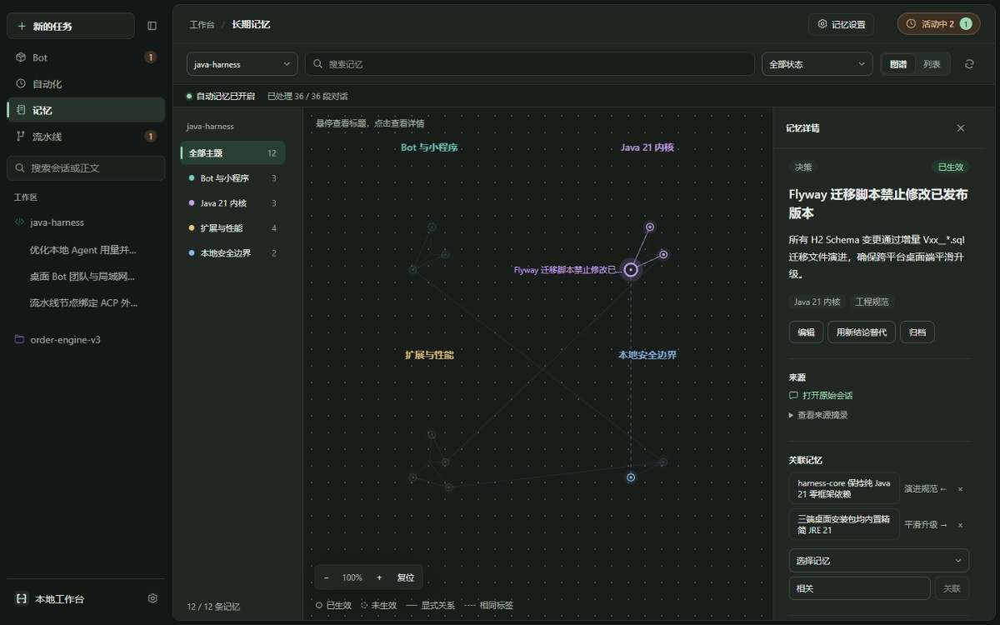

<div align="center">


# Java Harness

**用 Java 21 构建的本地优先 AI 编程工作台**

连接你选择的模型与项目工作区，将桌面 Bot 团队与互动小程序、全本机多 Agent 用量统计、<br>
人机泳道流水线、长期记忆图谱、局域网手机伴侣与 MCP / ACP 扩展生态汇聚于一处，所有数据留在你本机。

<p>
  <a href="https://github.com/song782360037/java-harness/actions/workflows/build.yml"></a>
  <a href="https://github.com/song782360037/java-harness/releases"></a>
  <a href="LICENSE"></a>
  
  
  
  
  
</p>

<p>
  <a href="#演示视频">演示视频</a> ·
  <a href="#核心亮点">核心亮点</a> ·
  <a href="#界面预览">界面预览</a> ·
  <a href="#快速开始">快速开始</a> ·
  <a href="#插件与扩展">插件与扩展</a> ·
  <a href="#系统架构">系统架构</a> ·
  <a href="#文档导航">文档导航</a> ·
  <a href="#参与贡献">参与贡献</a>
</p>

</div>

---

## 演示视频

https://github.com/user-attachments/assets/3023f521-b291-4e97-95d6-a081818ddae6

> 36 秒全实机演示：桌面 Bot 团队与 3D 翻面工位 · 沙箱互动小程序 · 6 大本机 Agent 用量统计与 9 套明暗主题 · 长期记忆知识图谱 · 人机泳道流水线（ACP 外部智能体 + 定时触发）· 局域网移动伴侣（`:4317` 扫码配对）与纯 Java 21 架构。

## 核心亮点

Java Harness 是一个运行在本机的开源 AI 编程工作台，提供 **Windows / macOS / Linux 跨平台桌面客户端**（内置精简 JRE，无需预装 JDK），也可作为单个可运行 JAR 在任意 JDK 21 环境中启动。

- **桌面 Bot 团队、互动小程序与手机伴侣**：组建多角色常驻数字员工团队（30 款原创矢量角色图库、3D 翻面工牌与明暗自适应工位、灵动岛、聊天/后台任务分离调度、跨 Bot `@` 静默委派、SOP 做法与例行定时）；支持让 Bot 现场生成沙箱单文件 HTML 互动小程序（收起支持 5 分钟热保活）；按需开启独立端口 `4317` 局域网手机伴侣，同一 Wi-Fi 下扫码输入 4 位配对码即可在手机端指挥 Bot 与打开小程序。
- **全本机多 Agent 用量全景与现代工作台**：自动聚合本机 **Java Harness、Claude Code、Codex、Antigravity、WorkBuddy 与 Qoder** 会话日志，提供多源堆叠趋势、365 天贡献热力图、缓存命中率与磁盘增量缓存预热；原生内置 **9 套精选明暗主题**（含纯白极简、翡翠、暖纸、晴空、落樱、午夜星蓝、暖棕咖啡、星云暗紫），配备工作区文件树与代码预览右侧栏、`Ctrl/Cmd+K` 命令面板及跨会话全文检索。
- **人机泳道流水线与定时自动化**：按需求生成固定研发流水线，AI 岗位支持绑定 `/claude`、`/codex` 等 ACP 外部智能体自动流转，关键节点在「你」泳道人工把关与打回闭环；定时自动化支持每天 / 工作日 / 每周 / 每小时 / Cron 自动新建会话或防重入触发流水线。
- **可追溯长期记忆图谱**：从历史对话中自动沉淀架构约定、工程偏好与排障经验，以主题聚类知识图谱呈现，支持显式关系连线、跨会话召回、原文来源追溯与人工纠偏。
- **多模型热切与开放扩展生态**：接入任意兼容 OpenAI Chat Completions 接口的服务或本地模型网关（支持瞬态错误自动重试与思考强度调节）；统一管理插件包、Markdown 技能、MCP 连接器（`stdio` 与 Streamable HTTP）以及外部 ACP 智能体（`/claude`、`/codex`）。
- **纯 Java 21 内核 · 本机优先**：`harness-core` 与 `harness-spi` 零框架依赖；主服务仅监听 `127.0.0.1`，会话、记忆与加密凭据保存在本机 H2 数据库，支持并行只读/实现子智能体与完整运行快照留痕。

## 界面预览

<table>
  <tr>
    <td align="center" width="50%">
      
      <br />
      <sub><strong>Bot 团队与互动小程序</strong> · 3D 翻面工位、跨 Bot 委派与沙箱 HTML 小程序</sub>
    </td>
    <td align="center" width="50%">
      
      <br />
      <sub><strong>全本机多 Agent 用量看板</strong> · 6 大本地 Agent 聚合趋势与 365 天热力图</sub>
    </td>
  </tr>
  <tr>
    <td align="center" width="50%">
      
      <br />
      <sub><strong>固定泳道流水线</strong> · AI / ACP 岗位自动流转与人工关键节点把关</sub>
    </td>
    <td align="center" width="50%">
      
      <br />
      <sub><strong>长期记忆图谱</strong> · 主题聚类、显式关联与原文来源追溯</sub>
    </td>
  </tr>
</table>

## 功能一览

| 能力 | 说明 |
| --- | --- |
| **Bot 团队工作台** | 聊天与后台任务双轨调度、跨 Bot `@` 静默委派、双区文件（资料库 + 绑定工作区）、SOP 做法与全局技能导入、例行定时、30 款原创 SVG 角色、3D 翻面工牌工位与灵动岛。 |
| **沙箱互动小程序** | Bot 可在后台生成单文件 HTML 互动看板或小工具，运行于沙箱 `iframe` 并通过 `window.harnessBot` 读写数据与反向通知 Bot，最小化后 5 分钟热保活。 |
| **局域网手机伴侣** | 默认关闭、按需启停的独立端口（`4317`）服务，支持同局域网扫码 + 4 位配对码与 HttpOnly Cookie 授权，在手机上查看 Bot 团队、收发消息与打开小程序。 |
| **多 Agent 用量统计** | 并行流式解析并增量缓存 Java Harness、Claude Code、Codex、Antigravity、WorkBuddy 与 Qoder 本机日志，展示堆叠趋势、缓存命中率、模型明细与近一年热力图。 |
| **固定泳道流水线** | 按需求生成可复用的岗位流转图，串联触发器、内置模型 / ACP 外部智能体岗位与「你」人工把关节点，支持打回补充闭环并接入任务中心与桌面通知。 |
| **定时自动化** | 配置提示词、工作区、模型与频率（每天 / 工作日 / 每周 / 每小时 / Cron / 手动），到点自动新建会话或防重入触发固定流水线。 |
| **长期记忆图谱** | 开启后自动从对话提炼项目记忆，在主题图谱中查看聚类、建立显式关系、人工纠偏并追溯原始会话出处。 |
| **工作台与代码浏览** | 内置右侧工作区文件树与语法高亮代码预览、`Ctrl/Cmd+K` 命令面板、跨会话全文检索、Markdown 导出、多模型热切与并行探索/实现子智能体（`explore` / `general`）。 |
| **9 套精选明暗主题** | 提供 5 套浅色（纯白极简、翡翠浅色、暖纸米白、晴空海蓝、落樱浅粉）与 4 套深色（翡翠深色、午夜星蓝、暖棕咖啡、星云暗紫），即切即存。 |
| **提示词优化与可控边界** | 结合最近对话、文件引用与相关记忆润色草稿；提供手动 / 智能 / 完全访问三档执行策略、命令规则及完整运行快照记录。 |

## 快速开始

### 方式一：下载桌面客户端（推荐）

前往 [Releases](https://github.com/song782360037/java-harness/releases) 选择对应平台安装包（均内置精简 JRE，无需预装 JDK）：

- **Windows (x64)**：`Java-Harness-Setup-<版本>-x64.exe`（支持应用内自动更新，数据保存在 `%APPDATA%\Java Harness\`）
- **macOS (Apple Silicon / Intel)**：`Java-Harness-<版本>-mac-arm64.dmg` 或 `Java-Harness-<版本>-mac-x64.dmg`（数据保存在 `~/Library/Application Support/Java Harness/`）
- **Linux (x64)**：`Java-Harness-<版本>-linux-x64.AppImage`（支持应用内自动更新）或 `Java-Harness-<版本>-linux-x64.deb`（数据保存在 `~/.config/Java Harness/`）

> [!NOTE]
> 安装包若未做代码签名：Windows 首次运行 SmartScreen 选择「仍要运行」；macOS 拖入应用程序后若提示无法验证，可在终端执行 `xattr -rd com.apple.quarantine "/Applications/Java Harness.app"`。

### 方式二：从源码构建运行

**环境要求**

- JDK 21（配置 `JAVA_HOME`）
- Node.js 22.12+（推荐 24 LTS）与 npm
- 无需单独安装 Maven（仓库自带 Maven Wrapper）

**构建与启动**

```bash
git clone https://github.com/song782360037/java-harness.git
cd java-harness

# 1. 构建前端工作台
npm --prefix harness-web ci
npm --prefix harness-web run build

# 2. 打包包含前端资源的后端 JAR（Windows 下使用 .\mvnw.cmd）
sh ./mvnw -B -ntp -Pweb clean verify

# 3. 启动本地服务
java -jar harness-server/target/harness-server-0.3.2.jar
```

启动后在浏览器访问 <http://127.0.0.1:8080/>，数据默认写入启动目录下的 `data/`。

### 首次配置

1. 打开 **设置 → 模型与提供商**，添加模型提供商（API 地址与 Key）并配置模型。
2. 点击 **新的任务**，在输入框底部选择项目工作区、模型与思考强度；或按 `Ctrl/Cmd+K` 快速打开命令面板。
3. 在左侧栏进入 **Bot**、**流水线**、**记忆** 与 **自动化**，或在 **设置** 中切换 **外观主题**、查看 **使用统计** 与开启 **局域网设备** 手机伴侣。

开发模式（前后端分别热启动）与端口配置说明见 [使用与开发参考](docs/usage-and-development.md)。

## 插件与扩展

在 **设置 → 扩展** 中统一发现、安装与管理插件、技能、MCP 连接器和外部智能体：

| 扩展类型 | 用途 | 接入方式 |
| --- | --- | --- |
| **插件（Plugins）** | 将技能、命令与工具打包为可复用的团队工作流（如代码审查、架构理解、发布检查）。 | 从本地目录或 ZIP 压缩包安装。 |
| **技能（Skills）** | 为特定工程任务注入方法论与规范（如根因分析、测试用例设计、技术文档），并支持一键导入 Bot 做法。 | 直接编写 Markdown 技能正文。 |
| **连接器（MCP）** | 将外部 MCP 服务提供的工具接入对话，支持 `stdio` 与 Streamable HTTP。 | 配置本地命令行程序或远端 MCP 服务地址。 |
| **外部智能体（ACP）** | 在对话、流水线岗位或 Bot 中委派任务给 Codex、Claude Code 或其他 ACP v1 智能体。 | 配置本地可信的 ACP v1 stdio 适配器。 |

在聊天输入框键入 `/` 可快速唤起插件命令与外部智能体。示例插件位于 [`examples/plugins`](examples/plugins)，详细说明见 [扩展使用与开发](docs/plugins.md) 与 [外部智能体（ACP）](docs/external-agents.md)。

<details>
<summary><strong>查看外部智能体（/claude、/codex）配置说明</strong></summary>

1. 安装对应的 ACP 适配器：[Codex ACP](https://github.com/agentclientprotocol/codex-acp) 或 [Claude Agent ACP](https://github.com/agentclientprotocol/claude-agent-acp)，并按上游文档完成本地认证。Java Harness 不安装适配器，也不转交自身模型 API Key。
2. 打开 **设置 → 扩展 → 外部智能体**，添加对应预设（可保留命令名或指定绝对路径），点击 **测试连接** 验证 ACP 握手后启用保存。
3. 回到对话并选择工作区，在消息开头输入 `/claude` 或 `/codex` 加任务描述（例如 `/claude 梳理项目模块之间的依赖`），也可在 **流水线** 岗位或 **Bot** 配置中直接绑定外部智能体。

> 外部任务在工作区第一个目录运行，不转发 Java Harness 的对话历史、记忆、附件或 MCP 配置，仍以当前系统账户权限运行（Codex 默认 `read-only`，Claude Code 默认 `plan`）。外部程序直接改动的文件无法在 Java Harness 内撤销。

</details>

## 系统架构

<p align="center">
  
</p>

```text
java-harness/
├── harness-spi/        Session / Run / Event 与引擎、模型、存储契约（纯 Java 21）
├── harness-core/       执行调度、上下文组装与预算、状态仲裁、取消与截止时间（纯 Java 21）
├── harness-adapters/   OpenAI 兼容 HTTP 适配、工作区工具、多 Agent 用量解析与 JDBC 存储
├── harness-server/     Spring Boot 装配、REST / SSE 接口、Bot / 局域网伴侣与 Flyway 迁移
├── harness-web/        前端工作台（Vue 3 + TypeScript + Vite）
├── harness-desktop/    Electron 桌面壳与 Windows / macOS / Linux 跨平台安装包构建
├── examples/           示例插件
└── docs/               架构设计、运行约定与开发文档
```

`harness-core` 与 `harness-spi` 保持**纯 Java 依赖**，不引入 Spring、数据库或 HTTP 客户端；适配层基于 JDK HttpClient、Jackson 与 Spring JDBC 实现；服务层负责 Spring Boot 装配、Bot 与局域网移动伴侣服务及数据库迁移。

## 安全与使用边界

- 面向**本机单用户**与**可信项目目录**，主服务默认仅监听本机回环地址 `127.0.0.1`。
- 局域网手机伴侣默认关闭，开启后运行在独立端口（默认 `4317`），采用 4 位配对码与 HttpOnly Cookie 授权，本地仅存令牌 SHA-256 哈希，随时可撤销设备。
- 模型 API Key 与连接器凭据均在本地加密保存，不会回显。
- 文件修改与命令规则属于尽力而为的工程防护，**不是操作系统级安全沙箱**；执行的命令仍具备当前系统账户权限，请勿在不信任的仓库中开启完全访问模式。
- 服务重启后可完整回看历史记录与调用快照，但不会自动续跑中断任务或重放外部调用。

## 文档导航

| 文档 | 内容说明 |
| --- | --- |
| [使用与开发参考](docs/usage-and-development.md) | 环境准备、源码构建、热启动开发、模型配置与工作区操作 |
| [扩展使用与开发](docs/plugins.md) | 插件、技能与 MCP 连接器的安装、配置及开发示例 |
| [外部智能体（ACP）](docs/external-agents.md) | 通过 ACP v1 接入 Codex、Claude Code 与自定义外部智能体、权限模式及续接规则 |
| [固定流水线](docs/flows.md) | 流程生成、岗位流转、人工审核节点与接口说明 |
| [长期记忆](docs/memory.md) | 自动提炼、历史回填、主题图谱与召回规则 |
| [提示词优化](docs/prompt-optimization.md) | 草稿优化流程、上下文与记忆来源 |
| [桌面客户端](docs/desktop.md) | Windows / macOS / Linux 安装包构建、发布、自动更新与数据目录 |
| [运行约定](docs/runtime.md) · [开发边界](docs/development.md) | 任务生命周期、审批模式、工程边界与编码约定 |
| [功能验证记录](docs/verification.md) · [扩展验证记录](docs/plugin-validation.md) | 各模块功能验证过程与结果 |

## 参与贡献

欢迎提交 Issue 和 Pull Request！

1. Fork 本仓库并基于 `master` 创建特性或修复分支。
2. 修改完成后在本地运行完整检查：

   ```bash
   npm --prefix harness-web ci
   npm --prefix harness-desktop ci --ignore-scripts
   npm --prefix harness-web run typecheck
   npm --prefix harness-web test
   npm --prefix harness-desktop test
   sh ./mvnw -B -ntp clean verify
   ```

3. Java 代码使用 [Spotless](https://github.com/diffplug/spotless)（`palantir-java-format`）格式化，请仅格式化改动文件，避免带入无关变更。
4. 提交信息遵循 [Conventional Commits](https://www.conventionalcommits.org/zh-hans/)（如 `feat: ...`、`fix: ...`、`docs: ...`）。
5. 涉及模块架构、数据库迁移或公共 SPI 契约的改动，建议先开 Issue 讨论方案。

GitHub Actions 会在 Windows 与 Linux 环境下自动运行完整构建与测试。

## 许可证

本项目基于 [MIT License](LICENSE) 开源。
