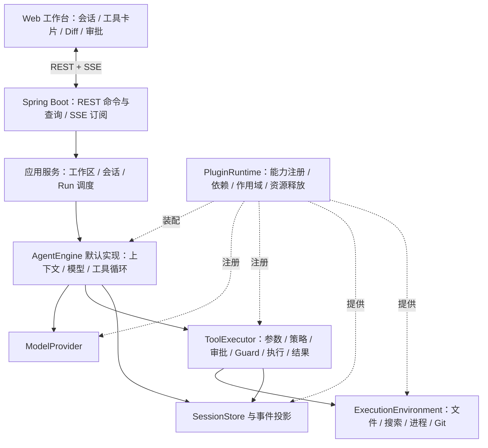

# Java Harness：调研与首版架构建议

状态：整体架构设计草案；工程骨架、最小执行闭环、OpenAI Chat Completions 通用流式适配、多轮上下文预算与请求消息快照已实现。当前实现范围以根目录 README 和 runtime.md 为准，其余仍属规划；真实账户联调尚未执行。
日期：2026-09-09。

用户已确认：做带 Web 界面的编程助手；本机启动 Java 服务，通过浏览器操作本机代码。

## 1. 建议定位

做一个 Java 原生、可扩展的本地编程 Agent 运行时，配套 Web 工作台。首版完成“理解仓库 → 修改代码 → 执行构建/测试 → 展示变更和结果”的闭环。

核心借鉴 DeepSeek Harness 的能力替换、作用域、工具执行治理和可重建会话。Java 版重新定义适合 Java 的接口与生命周期，不承诺兼容原项目的 Node/Cordis 插件，也不承诺与其全部功能一比一对应。

以下技术选型是建议，尚未被用户逐项确认：Java 21、Spring Boot、Maven、Vue 3 + TypeScript + Vite、H2 文件数据库。Spring Boot 的具体维护版本在实施时核实后锁定。

## 2. 调研来源与可信度

### 2.1 DeepSeek Harness 官方项目

仓库默认分支为 `master`。本次架构文档与核心源码核对使用固定 Git tree/ref：`5dda764ed3aa172535a7967b06ff95d9cbfe536a`，避免后续分支变化影响结论。当前 README 标明 developer preview，仍有兼容性变化。

已经阅读官方架构文档及 Agent 主循环、工厂生命周期、工具调度和工具注册执行的关键实现片段；没有安装运行官方项目，也没有执行其测试。这是有源码支撑的设计调研，不是完整代码审计或运行验证。

| 来源 | 核实内容 |
| --- | --- |
| [README](https://github.com/deepseek-ai/deepseek-harness/blob/5dda764ed3aa172535a7967b06ff95d9cbfe536a/README.md) | 项目已有 Web UI，使用 Cordis，MIT，开发预览状态 |
| [官方架构](https://github.com/deepseek-ai/deepseek-harness/blob/5dda764ed3aa172535a7967b06ff95d9cbfe536a/docs/architecture.md) | 模型、工具、会话、Agent 循环都是可替换插件；profile/bundle 装配；事件与上下文投影 |
| [Cordis primer](https://github.com/deepseek-ai/deepseek-harness/blob/5dda764ed3aa172535a7967b06ff95d9cbfe536a/docs/cordis-primer.md) | 服务依赖、作用域、事件分发方式、可撤销注册 |
| [Agent 工厂](https://github.com/deepseek-ai/deepseek-harness/blob/5dda764ed3aa172535a7967b06ff95d9cbfe536a/packages/core/agent-loop/src/index.ts#L416) | 将默认循环注册为 factory；创建与恢复拥有资源生命周期 |
| [Agent 主循环](https://github.com/deepseek-ai/deepseek-harness/blob/5dda764ed3aa172535a7967b06ff95d9cbfe536a/packages/core/agent-loop/src/agent.ts#L269) | turn → step → 模型请求 → 工具调用 → 继续或结束 |
| [请求构造](https://github.com/deepseek-ai/deepseek-harness/blob/5dda764ed3aa172535a7967b06ff95d9cbfe536a/packages/core/agent-loop/src/agent.ts#L603) | 从 `session.deriveMessages()` 获取并冻结模型历史 |
| [工具注册](https://github.com/deepseek-ai/deepseek-harness/blob/5dda764ed3aa172535a7967b06ff95d9cbfe536a/packages/core/tools/src/index.ts#L1027) | 作用域内注册工具，返回对应的撤销函数 |
| [工具执行准备](https://github.com/deepseek-ai/deepseek-harness/blob/5dda764ed3aa172535a7967b06ff95d9cbfe536a/packages/core/tools/src/index.ts#L1453) | pre-execute → 审批 → 不可放宽的 guard → dispatch；检查取消 |
| [工具调度](https://github.com/deepseek-ai/deepseek-harness/blob/5dda764ed3aa172535a7967b06ff95d9cbfe536a/packages/core/agent-loop/src/tool-calls.ts#L60) | 可并发工具的有界执行与独占屏障；取消后的调用结果配对 |
| [执行管线图](https://github.com/deepseek-ai/deepseek-harness/blob/5dda764ed3aa172535a7967b06ff95d9cbfe536a/docs/tool-execution-pipeline.md) | policy、审批、guard、执行、post、最终结果、会话记录的关系 |

官方最值得保留的设计：

1. **替换能力实现。** 上层依赖服务接口；新增模型或切换文件执行环境无需改 Agent 循环。
2. **注册有归属。** 插件注册的工具、监听器、提示词、任务能随插件生命周期撤销。
3. **能力有作用域。** 全局、工作区和会话的配置与能力集明确隔离。
4. **会话是事实来源。** 模型上下文来自会话记录的投影；前端也从同一事实来源恢复。
5. **执行有统一入口。** 文件工具、Shell、外部工具都通过统一管线。
6. **启动、停止和恢复有所有权。** 先取得会话写权限再恢复；停止需要取消并等待资源收尾。

“Everything is a plugin” 不只是 JAR 自动发现。SPI 解决入口发现，ClassLoader 解决部分加载/依赖隔离；依赖激活、作用域、注册撤销、运行中的资源归属，还需要宿主运行时实现。

### 2.2 公众号文章

已通过浏览器阅读：[《Java + DDD，1:1 复刻 Deepseek Harness 项目！》](https://mp.weixin.qq.com/s/h9PIIfZI9C8gVtzT_z_a_g)，作者小傅哥 / bugstack虫洞栈，页面日期 2026-09-07。

直接 HTTP 请求返回验证页，但正常浏览器访问取得了正文。没有访问其社群受限源码或运行文章提供的镜像。

文章自述：Java 17/21 + Spring Boot 3.3.x、DDD 六边形架构、26 个内置工具、27 个领域模块、Java SPI / Node sidecar / MCP 扩展、权限审批、会话事件持久化、原生 JS Web 控制台、MySQL/H2。数量和实现完整性属于作者陈述，不能视为已验证结果。

| 文章设计 | 本项目建议 | 原因与边界 |
| --- | --- | --- |
| 端口与适配器分离 | 采用 | 引擎不依赖数据库、HTTP Controller 或具体模型协议 |
| 统一 ToolCallExecutor + PRE/POST Hook | 采用，并增加固定 guard 边界 | 插件扩展不能跳过最终权限检查 |
| SSE、工具卡片、审批、历史回放 | 首版采用 | 编程助手需要过程、控制和结果，不只聊天文本 |
| H2 standalone profile | 首版默认采用 | 本机运行无需额外数据库服务 |
| Java SPI / ClassLoader 插件 | 分阶段采用 | 先做可信内置插件和清理契约，再做外部 JAR |
| Node sidecar 插件兼容 | 后置 | JSON-RPC 桥不等于完整兼容 Cordis 的上下文和生命周期 |
| 27 个领域模块、多层 Facade/编排 | 暂不照搬 | 首版按实际状态和依赖边界划分；子包数量不等于限界上下文数量 |
| 原生 JS 无构建链 | 不作为默认 | 工作台有流式卡片、审批、Diff、多会话，组件化前端更适合演进 |
| 事件溯源 | 采用会话追加事件及投影，控制范围 | 不把所有配置 CRUD 都做成事件溯源；回放不重新执行副作用 |

特别注意：`URLClassLoader` 不是安全沙箱，也不能保证类立即卸载。插件留下的线程、静态引用和监听器都可能阻止释放。文章介绍无法证明这些问题已处理，也不能据此判定其实现存在缺陷。

## 3. 建议架构



首版是一个 Java 进程、一个文件数据库和一个前端应用。Spring 管装配与 Web 生命周期；Agent、工具、审批、事件的业务契约保持普通 Java 接口，避免绑定 Spring Bean 热刷新机制。

Maven/前端建议目录：

```text
java-harness/
  harness-spi/          插件、工具、模型、执行环境、存储、AgentEngine 契约
  harness-core/         默认引擎、运行状态、上下文投影、工具管线、审批、插件运行时
  harness-adapters/     模型 HTTP、H2、文件、搜索、进程、Git 等内置实现
  harness-server/       Spring Boot、应用服务、REST、SSE、启动配置
  harness-web/          Vue 3 + TypeScript，工具卡片、Diff、设置
  docs/
```

依赖方向：`core → spi`，`adapters → spi`，`server → core + adapters + spi`。前端只依赖 Web 协议。后续某类适配器需要独立发布时再拆 Maven 模块。

建议先按以下业务边界组织包：`workspace`、`session`、`run`、`tool`、`approval`、`plugin`。模型调用、数据库、文件系统属于明确端口，不为了套 DDD 增加没有逻辑的转发层。

## 4. 必须先明确的运行契约

### 4.1 会话、执行与步骤

- `Workspace`：已登记的项目根目录、执行环境与策略。浏览器提交 workspaceId，不能随每次调用任意指定服务器路径。
- `Session`：一个工作区内的长期对话与追加事件流。
- `Run`：处理一次用户请求的执行生命周期；一个 Session 首版最多一个活动 Run。
- `Step`：一次模型请求及其产生的工具调用。
- `ToolCall`：一次确定的调用身份、参数快照、审批及执行结果。

首版对重复提交使用客户端 requestId 去重；同会话忙碌时返回明确冲突，不默认开启第二个并发引擎。不同会话访问同一工作区时，首版串行化会修改工作区或启动命令的 Run，避免写冲突。

建议 Run 状态：

```text
QUEUED → RUNNING ⇄ WAITING_APPROVAL
              ⇄ WAITING_INPUT
RUNNING → COMPLETED / FAILED
QUEUED → CANCELLED
活动状态 → CANCELLING → CANCELLED
进程异常退出后尚未结算的活动状态 → INTERRUPTED
```

达到步数、时间或 token 预算以明确原因停止，不能显示为正常完成。审批拒绝形成工具失败结果，引擎可以解释或选择其他合法工具，不自动放行同一动作。

取消传播到模型 HTTP 请求、审批等待和进程执行。已开始的外部进程未确认结束前保持 `CANCELLING`。Java 线程中断只是协作取消信号，不能据此声称 Shell 已停止。

### 4.2 模型与上下文

`ModelProvider` 输出统一事件：文本增量、工具调用增量、用量、结束原因和错误。模型适配器负责协议差异；不要把供应商特定响应对象流入 core。

模型接入统一使用 OpenAI Chat Completions 兼容协议，通过基础地址、Key、模型名配置访问服务。当前实现文本流，工具调用仍属后续规划。是否兼容必须通过适配器测试确认，不能由 baseUrl 相同风格推断。

建议先自己实现可理解的 Agent 循环，模型调用适配器使用 HTTP 客户端；Spring AI / LangChain4j 如有需要可在适配器内部引入。避免把工具执行和循环再委托给另一套自动 Agent，否则审批、事件记录和重试容易出现双重控制。

模型请求内容从持久化会话事件生成，保存实际生效的系统提示词、已接收的输入、模型/工具配置与工具结果。大文件和大输出截断后的模型可见内容也要可重建。

当前文本对话已实现字符预算：按完整问答移除最早历史，页面明确显示裁剪轮数，并保存实际消息快照。文件分段、搜索限量、工具输出限额仍属规划。自动摘要压缩后置；未来工具循环需定义 tool-call/tool-result 配对及裁剪策略，不能无提示丢弃或拆散。

### 4.3 工具执行

工具统一入口：

```text
记录 ToolCall 提议与身份
→ 解析与参数校验
→ 固化 toolId、providerVersion、workspaceId、参数快照
→ 可扩展策略评估 ALLOW / ASK / DENY
→ 必要时等待用户审批
→ 固定 Guard 复查调用身份、路径与权限
→ 执行前状态记录
→ 工具执行
→ 输出规范化、限额与扩展处理
→ 结果定稿并持久化
→ UI 投影与模型上下文
```

审批绑定具体 ToolCall 和参数摘要；批准后参数、插件版本或目标发生变化必须失效。取消与审批答复用状态版本/CAS 仲裁，迟到的批准不能重新启动已取消任务。策略允许也不能覆盖固定 Guard 的拒绝。

首版建议 8 类工具：目录列举、文件读取、文本搜索、受检补丁、新文件写入、命令执行、Git status/diff 查询、向用户提问。只读工具默认可用，修改文件及执行命令按工作区策略审批；可明确授予会话内权限以减少重复操作。

补丁必须校验读取时的内容版本/哈希；文件已被用户修改时返回冲突。不得将恢复聊天、恢复 Run 或取消任务解释为撤销文件变更。

文件与子进程必须属于同一个 `ExecutionEnvironment`，以便未来整体切换为容器环境。工作区路径检查应考虑 Windows 大小写、符号链接/junction、目录穿越及创建新文件时的父路径；普通路径校验仍不是 OS 级沙箱。

### 4.4 Windows 命令与 Git

使用 `ProcessBuilder` 明确 executable、argv、cwd、环境变量。Maven 优先识别 `mvnw.cmd`，Gradle 优先识别 `gradlew.bat`；Shell 语义必须由独立 PowerShell 适配器显式处理，不假设 Bash 存在。

需要并发消费 stdout/stderr，限制内存、运行时间和输出长度，记录退出码及输出文件。Windows 子进程树终止需要单独验证，必要时使用 Job Object 等平台实现，不能只杀父进程。

首版直接在用户选定仓库工作，开始前记录 Git 状态，保护已有未提交和未跟踪文件。UI 展示的工作区 Diff 应与本次 Run 的文件变更记录区分；不能把用户原有修改全算成 Agent 产物。Git worktree 隔离和选择性应用变更可在后续阶段加入。

### 4.5 插件

建议核心接口（接口名为设计提案，不是现有代码）：

| 接口 | 责任 |
| --- | --- |
| `HarnessPlugin` | 元数据、依赖声明、启动、停止 |
| `PluginContext` | 受作用域约束的注册与服务查询 |
| `Registration extends AutoCloseable` | 幂等撤销本次注册 |
| `AgentEngine` | 可替换的 Run 执行入口 |
| `Tool` / `ToolDescriptor` | Schema、能力描述、执行 |
| `ModelProvider` | 模型请求、流、错误与取消 |
| `SessionStore` | 追加事件、读取、写所有权与投影恢复 |
| `ExecutionEnvironment` | 文件、搜索、进程等同一执行世界 |

首版支持随应用发布的可信插件，配置启用，启动时装配；全局与 Session 作用域由宿主管理。默认引擎也通过接口装配，保留后续替换入口。

下一阶段再做外部 Java JAR：稳定 SPI 包、清晰类加载委派、依赖版本与重复服务检测、ServiceLoader 发现、启停管理。停止插件先禁止新调用，等待或取消其活动调用，再逆序释放注册、监听器、进程等资源。首个外部插件版本可要求重启生效，不急于热更新。

第三方不可信代码应走独立进程/容器。MCP 与 Java 插件最终都注册为同一种 Tool，走相同执行管线。Node sidecar 和 Cordis 插件兼容是另一个工程目标，不能顺带承诺。

## 5. Web 协议和工作台

建议 Vue 3 + TypeScript + Vite，Diff 使用 Monaco Diff Editor；首版终端以命令日志卡片展示，交互式 PTY 终端后置。前端构建产物可打入 Spring Boot JAR，使最终用户无需安装 Node。

主界面：左侧工作区/会话列表，中间对话与工具执行时间线，右侧文件和 Diff；审批卡片展示准确命令、目标路径和拟写入内容。用户始终能看到 Run 状态、停止按钮、测试结果与错误原因。

建议接口：

| API | 语义 |
| --- | --- |
| `POST /api/workspaces` | 登记本地工作区 |
| `POST /api/sessions` | 创建会话并绑定工作区 |
| `POST /api/sessions/{id}/runs` | 幂等提交请求，返回 runId |
| `GET /api/sessions/{id}` | 获取会话状态和当前快照 |
| `GET /api/sessions/{id}/events?after={seq}` | 订阅 SSE，并补发已提交事件 |
| `POST /api/runs/{id}/cancel` | 请求取消，响应不等于资源已收尾 |
| `POST /api/approvals/{id}/decision` | 提交批准/拒绝，校验版本和归属 |
| `POST /api/questions/{id}/answer` | 回复 Agent 提问 |
| `GET /api/workspaces/{id}/changes` | 查看工作区变更及本次 Run 记录 |

浏览器关闭或 SSE 断线默认不取消 Run，重连按序号补齐。持久化事件有单调递增 seq，客户端去重；订阅时需要覆盖“历史补发到实时订阅”的竞态窗口。

临时文本增量与已提交事件分开：增量用 runId/stepId/attemptId/offset 标识，可只保存在内存；最终消息或中断消息落库后替换草稿。断线可恢复最近提交结果，不能保证恢复硬崩溃前所有未落盘字符。对慢客户端限流/断开后补发，避免它阻塞模型执行。

服务默认只监听 `127.0.0.1`；做 Host/Origin 校验、启动会话认证与变更请求校验。用户填写的模型 Key 仅在后端使用，日志和前端响应脱敏。远程访问/多租户不属于这个本地版本的默认部署能力。

## 6. 持久化与恢复

推荐 H2 文件库 + 显式版本化迁移；后续通过适配器增加其他数据库。首版无 Redis、消息中间件或分布式调度依赖。

逻辑数据：Workspace、Session、Run、SessionEvent、ToolExecution、Approval、ModelConfig。Run 状态和事件追加保持事务一致；`(sessionId, seq)` 唯一，ToolCall 身份唯一。

两条投影：模型消息投影与 Web 时间线投影。配置修改与列表查询可以普通 CRUD，历史回放只生成状态和展示。

崩溃恢复不等于自动重做：若工具已经产生文件或进程副作用，却没来得及保存结果，应记录“结果未知/执行中断”，重新检查工作区，等待用户选择继续。没有幂等保证的写入和命令不能盲目重试。模型请求重试也应区别尚未输出、已部分输出和已产生工具调用的情况。

## 7. 分期交付与验收

| 阶段 | 交付 | 核心验收 |
| --- | --- | --- |
| A：运行骨架 | Web、会话、模型流、事件库、Fake ModelProvider、可替换引擎接口 | 刷新可恢复已提交消息；模型失败原因可见；停止能结束模型请求 |
| B：编程闭环 | 搜索/读写/补丁、命令、Git Diff、审批、预算 | 能为演示 Java 仓库修复一个缺陷并运行测试；拒绝审批确实无副作用 |
| C：扩展与长任务 | 外部 Java 插件、MCP、上下文压缩、工作区隔离 | 示例插件无需改 core；卸载无残留注册；压缩不破坏调用配对 |
| D：按实际需要扩展 | JavaParser/LSP、后台作业、子 Agent、远程隔离执行 | 有实际使用场景与独立验收再加入 |

首版可用交付为 A + B。首版的关键价值是任务闭环、过程可见、执行可控和会话可恢复。

测试矩阵至少包含：

- 模型流的文本/工具调用分片、非法参数、错误、超时、取消、预算耗尽。
- 工具请求与结果配对；拒绝和取消不执行工具；取消与批准竞态；审批重复提交。
- SSE 断线补发、重复事件去重、慢客户端、会话忙碌冲突。
- 文件并发修改、路径越界、符号链接/junction、含空格路径、中文文件名。
- 命令 stdout/stderr 大量输出、退出码、超时及子进程收尾。
- 进程在写文件后/保存结果前崩溃：不得自动重复执行。
- 插件初始化失败回滚、同名服务冲突、Session 关闭后的资源清理。
- 真实模型接入需用户提供本地配置，再做端到端验证；Fake Provider 测试通过不等于真实模型已验证。

不参考文章中的“2 周、2.2 万行”作为工期依据。完成 A 的原型、评估 Windows 进程控制与真实模型差异后，再根据验收范围估算。

## 8. 开发前的剩余决策

已确认：Web、本机、Java 后端。

建议默认：Java 21 + Spring Boot；Vue 3；H2；单实例单用户；一个 Session 一个活动 Run；第一版工具顺序执行；可信内置插件；配置重启生效；当前工作区直接编辑并检查基线。

需要在进入实现时确认的偏好：前端是否接受 Vue 3，模型首先接入哪一家/哪种协议，以及首版是否就需要外部 JAR 插件。其余可按以上默认开始，无需一次讨论完后续所有能力。

本稿记录调研阶段的业务规划。后续工程骨架的构建、启动方式和验证边界见 [README](../README.md)，不可将这里的规划视为已实现功能。
