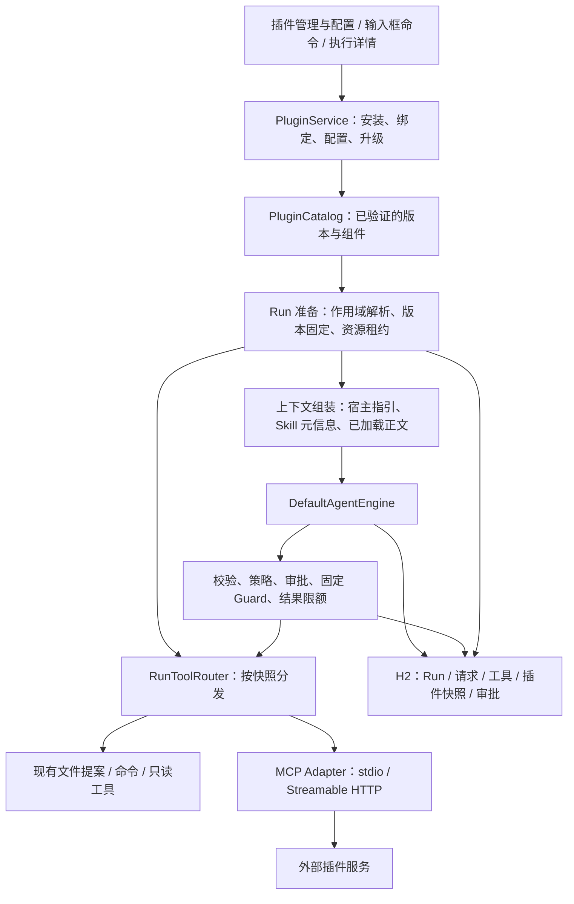

# Java Harness 插件系统：竞品调研与架构建议

日期：2026-10-22。状态：调研方案已确认，A+B 已实施；以下设计目标需结合末尾实施边界阅读。

本地源码基线：`a009e86df15861a112f1e13ae53f1c040fb98839`。外部资料按访问当日内容分析，默认分支和在线文档可能变化。本轮实现固定 Agent Plugins 1.0.0 子集及 MCP Java SDK 0.17.2，具体契约见 [插件文档](plugins.md)。

## 1. 推荐结论

推荐采用 **“Java 内部能力契约 + 标准化外部插件包 + 统一执行治理”** 的两层扩展架构。

- 内部能力层延续现有 SPI：模型、工具、上下文贡献等通过接口装配，注册必须有所有者、作用域和释放契约。借鉴 DeepSeek Harness，但按真实需要逐步引入，不先重写整个引擎。
- 外部插件层以 Skills、Commands、MCP 为首版能力，使用目录/ZIP 交付；优先采用 Agent Plugins 可移植格式，平台专用字段放入 `extensions.dev.javaharness`。
- 插件执行进入现有 Run 的预算、取消、工具记录和请求快照体系；外部工具另补通用审批，继续保留文件提案、命令审批的专有语义。
- 界面先由平台提供插件管理、配置表单和执行记录；交互面板后续采用 MCP Apps，适配浏览器隔离机制。

本建议沿用 [原架构稿](architecture-proposal.md) 中能力替换、作用域、可撤销注册的方向，调整的是实施顺序：先交付可安装、可调用、可追溯的外部能力包，再评估外部 JAR 和深层运行时替换。此前稿件中的规划不作为已实现能力。

适用假设：平台继续定位为 Java 后端、本机单用户、浏览器工作台、命名多目录工作区。当前没有提出多租户、远程执行和第三方代码强隔离需求。若产品目标变为这些方向，需要单独补执行环境和身份架构。

## 2. 调研口径与证据边界

“插件系统”至少包含四件事：能力如何编写、如何分发安装、如何装配执行、如何管理权限与生命周期。只有一个 `Plugin` 接口，或只有一个插件商店页面，都不足以构成完整系统。

| 概念 | 解决的问题 | 在本方案中的位置 |
| --- | --- | --- |
| Plugin | 相关能力的身份、版本、分发和管理 | 安装、启停、更新的单位 |
| Skill | 如何完成一类任务 | 指令、参考资料、脚本和模板，按需加载 |
| Command | 用户如何主动启动固定工作流 | `/插件名:命令名`，展开成指令与结构化选择 |
| MCP | 如何接入外部工具和数据 | 标准协议适配器，不替代宿主权限和业务审核 |
| Hook | 在哪个执行阶段扩展行为 | 必须区分只读通知、上下文贡献和阻断策略 |
| Agent preset / Subagent | 角色配置 / 独立子任务执行 | 角色配置不等于已实现子 Agent 调度 |
| UI extension | 如何展示和操作结构化结果 | 受限面板；不直接注入主应用运行时 |

已阅读六类产品的官方文档，并抽查 DeepSeek 工具注册源码、客户端模块契约以及 ZCode UI Bridge 契约。未安装运行竞品，未执行其测试，也没有完成竞品全量源码审计。Codex、Claude Code 和 Qoder 的结论主要属于公开扩展契约，不能据此断言其全部内部实现。GitHub 部分文件抓取失败处，没有把对应实现算作已核实。

## 3. 市场方案比较

以下产品事实与“建议借鉴”的判断分开：表格中的启示是本项目的架构判断。

| 产品 | 可确认的扩展路线 | 核心特点 | 对我们的启示 |
| --- | --- | --- | --- |
| Codex | Skills + MCP + 可选 UI / Hooks 的安装包 | 工作流指导与工具服务分工，具有可移植包和兼容布局 | 对外以能力包为单位；无需每个插件都开发界面 |
| DeepSeek Harness | Cordis 运行时，一切能力可插件化 | 服务依赖、作用域、可撤销注册、生命周期 | 借鉴运行时纪律，逐步扩展内部能力接口 |
| ZCode | Skills / Commands / Agents / MCP / Hooks 组合包；另有 UI Plugin 路线 | 兼容生态、插件组件统一管理、MCP Apps 交互页面 | 明确包、组件、页面和业务数据的不同生命周期 |
| Qoder | IDE / 桌面 / CLI 上的组合包 | 用户/项目范围、来源归属、配置与加载诊断 | 管理体验与作用域是首版能力，不宜事后补 |
| Claude Code | 技能、Agent、Hooks、MCP 等统一安装 | 命名空间、市场清单、校验、用户配置 | 学习低门槛创作与静态验证；兼容应逐组件声明 |
| OpenCode | 原生代码插件，当前 V2 有 setup / cleanup、注册与 transform | 深度行为扩展、工具快照、服务端与终端扩展分工 | 借鉴稳定执行快照和清理；不直接引入另一套 JS 宿主 |

### 3.1 Codex：插件是交付单位，Skill 与工具服务各有职责

官方将插件定位为可安装包：Skills 描述工作流，MCP 提供工具、鉴权与外部服务连接，UI 按需要提供。Skills 先向模型提供元信息，匹配任务后再加载完整指令。这适合避免所有插件正文常驻上下文。[插件架构](https://developers.openai.com/plugins/concepts/plugins)、[Skills](https://developers.openai.com/plugins/concepts/skills)

当前官方文档同时描述根目录 `plugin.json` / `mcp.json` 的 Agent Plugins 格式，以及 `.codex-plugin/plugin.json` 兼容布局。打包 Hooks 具有安装表面和信任限制，不能理解成“安装即获得任意脚本执行权”。[打包规范](https://developers.openai.com/plugins/build/plugins)

借鉴：安装与权限配置统一管理，工具与指令分开。我们可以读取共同组件；不承诺复用 Codex 私有 connector ID、账号授权或其专属 UI 能力。

### 3.2 DeepSeek Harness：最值得借鉴的是注册所有权与执行管线

用户指定的 [官方仓库](https://github.com/deepseek-ai/deepseek-harness) 基于 Cordis，当前仍标注开发预览。插件通过 `apply(ctx, config)` 等入口注册能力，`inject` 声明服务依赖，`ctx.effect` 关联资源清理。依赖消失时，相应插件卸载，依赖恢复后再装载。[入门](https://deepseek-harness.github.io/deepseek-harness/en/develop/basic/)、[生命周期](https://deepseek-harness.github.io/deepseek-harness/en/develop/framework/)

工具执行进一步区分可扩展策略与最终 guard；源码定义的 `ToolGuard` 只能拒绝或保持原判定，不能把拒绝变为允许。注册清理、作用域和取消传播有独立契约。[工具模块](https://github.com/deepseek-ai/deepseek-harness/tree/master/packages/core/tools)、[源码](https://github.com/deepseek-ai/deepseek-harness/blob/master/packages/core/tools/src/index.ts)

其 Web 插件还涉及模块加载、版本化资源、依赖图与浏览器端生命周期，并非简单加载一个 JS 文件。[客户端模块源码](https://github.com/deepseek-ai/deepseek-harness/blob/master/packages/client/modules/src/client/manifest.ts)

借鉴：每项注册都知道由谁创建、在哪生效、如何撤销；固定校验不受 Hook 排序影响。本项目暂不复刻 Cordis 的动态服务图，也不把依赖作用域当作 OS 沙箱。[官方安全边界](https://github.com/deepseek-ai/deepseek-harness/blob/master/SAFETY.md)

### 3.3 ZCode：组合包之外，UI Plugin 也值得保留演进方向

用户指定的 [zai-org/ZCode](https://github.com/zai-org/ZCode) 包含工作台和 Agent 运行时。官方插件文档说明了 `.zcode-plugin/plugin.json`、Claude 插件布局兼容、五类组件和 MCP 命名空间，也明确列出部分字段仅登记而不执行。[插件文档](https://zcode.z.ai/cn/docs/plugin)

仓库另有 UI Plugin 文档：通过 MCP Apps 连接页面与服务，把工具调用和用户交互作用于同一业务文档；视图状态与持久文档分开。该文档限定桌面本地工作区，并对开发分支准备情况和发布版本兼容范围作了保留说明，不能外推为全部 Web/远程版本已支持。[UI Plugin](https://github.com/zai-org/ZCode/blob/main/UI_PLUGIN.md)

源码旁的 Bridge 契约要求绑定 runtime/token/generation，调用与审批归 Agent 所有，Host 不重放工具。这比只核对插件名更适合处理页面过期、工作区切换和连接替换。[Bridge 契约](https://github.com/zai-org/ZCode/blob/main/packages/services/src/plugin-ui-bridge/CONTRACT.md)

借鉴：后续用 MCP Apps 做报告、画板或结构化编辑器；平台保有审批入口，插件服务保有业务文档。我们的浏览器环境不能直接照搬 Electron guest 的隔离实现。

### 3.4 Qoder：扩展治理和用户体验比较完整

IDE 文档描述将 Skills、MCP、Agents、Commands、Rules、Hooks 打包，区分用户/项目安装范围，子组件标记来源并随父插件管理。[IDE 插件](https://docs.qoder.com/extensions/plugins)

CLI 文档给出 `.qoder-plugin/plugin.json`、常规目录、marketplace 清单、启停/校验/重载及来源限制；不受信项目目录不会加载相应项目级扩展。IDE、桌面和 CLI 契约应分别看待。[CLI 清单](https://docs.qoder.com/cli/plugins-reference)、[加载与信任诊断](https://docs.qoder.com/cli/troubleshoot-extensions)

借鉴：每个 Skill、工具都显示来源插件；用户知道为什么未生效。项目可携带扩展推荐，但不因检出仓库自动执行其中的代码。

### 3.5 Claude Code：低门槛作者体验与显式兼容边界

其插件通过技能、Agent、Hooks、MCP 等组件组合，市场只是发现和获取插件的目录。清单位于 `.claude-plugin/plugin.json`，组件位于插件根；有命名空间、路径校验、用户配置和静态校验命令。[概览](https://code.claude.com/docs/en/plugins)、[清单](https://code.claude.com/docs/en/plugins-reference)

Hook 是独立的生命周期扩展，具有事件输入与决策语义，不能当作普通提示词文件加载。[Hooks](https://code.claude.com/docs/en/hooks)

借鉴：用 Markdown/JSON 就能编写有用插件。导入 Claude 插件时给出支持矩阵；不能只解析成功就声称完整兼容所有 Hook、Agent 和运行时变量。

### 3.6 OpenCode：须区分 V1 和 V2

V1 公开插件接口是 JS/TS 函数返回 Hooks；当前 V2 文档使用 `Plugin.define`、`setup`、清理函数和各能力域的注册/transform。两者不能混合成一套示例。[V1](https://dev.opencode.ai/docs/plugins/)、[V2](https://opencode.ai/v2/docs/build/plugins)

V2 文档明确每次模型请求捕获可执行工具快照；后续注册变更影响未来快照，而闭包中的可变数据仍需要作者自行约束。其包管理支持版本或提交固定。[V2 加载与版本](https://opencode.ai/v2/docs/plugins)

借鉴：模型看到的工具定义与实际执行对象必须一致。我们的首版进一步固定到整个 Run，降低中途更新与审核身份变化的复杂度。

### 3.7 新的共同格式：Agent Plugins

当前 Agent Plugins 1.0.0 以根目录 `plugin.json`、`skills/`、`mcp.json` 为可移植基础，客户端差异放在反向域名扩展中；安装、权限和 UI 仍由客户端负责。[规范入口](https://agent-plugins.org/)、[Manifest Schema](https://agent-plugins.org/schemas/1.0.0/plugin.schema.json)、[MCP Schema](https://agent-plugins.org/schemas/1.0.0/mcp.schema.json)

这是本轮比各家私有目录更值得优先采用的共同基础。但首版只支持其中明确列出的能力子集，未完成全部规范验收前不声明完整标准符合性。

## 4. 我们平台当前的真实接入点

当前源码是 Java 21、Spring Boot 3.5.16、H2/Flyway、Vue 3。README 明确插件和通用审批属于后续范围。下列结论已通过当前源码复核，而非沿用早期记忆中的版本状态。

| 当前能力 | 代码证据 | 插件设计含义 |
| --- | --- | --- |
| 模块依赖明确 | 根 POM；`core → spi`，`adapters → spi`，`server → core + adapters` | 保留模块，先增加子包，暂不拆一串新模块 |
| 提交先处理幂等重试，再捕获配置 | `DefaultAgentEngine.java:60`、`:62` | 插件选择与快照需遵守同样顺序 |
| 每 Run 打开并释放资源 | `RunConfiguration.java`；`DefaultAgentEngine.java:217` | 为插件连接建立 Run lease 与收尾归属 |
| 工具由 SettingsService 固定装配 | `SettingsService.java:113`、`:122` | 从这里抽出运行资源装配，不在 Controller 临时加工具 |
| 多目录工具必须选择 root | `MultiWorkspaceTools.java:19` | 本地工具保留此路由；远程工具不应被强加 root 参数 |
| 引擎统一调用工具并记录状态 | `DefaultAgentEngine.java:197` | 扩展工具进入同一引擎，不另写 MCP Agent 循环 |
| TokenBudget 已计算工具和系统指令 | `TokenBudget.java`；`DefaultAgentEngine.java:120` | Skill 正文、目录元信息与新增工具必须一起计算 |
| 每次实际模型请求持久化 | `ModelRequest.java`；`DefaultAgentEngine.java:162` | 保留实际发送内容，再增加插件归属证据 |
| 文件改动是提案，用户另行应用 | `ReviewWorkspaceTools.java`；`FileChangeService.java:95` | 不能让插件复用 apply 为模型工具 |
| 命令审批已有专有状态与进程控制 | `CommandService.java:68`、`:95` | 可复用模式，不能拿命令字符串冒充通用 MCP 审批 |
| 当前工具结果是文本 | `WorkspaceTools.java:6` | 首版明确文本/有界 JSON，图片、UI 需后续协议扩展 |
| 工具名限制为 64 个 ASCII 标识字符 | `ToolCall.java:7` | 外部名字要映射，不能直接使用冒号、点或超长名字 |
| 本机 API 具有 Host/Origin 边界 | `LocalApiFilter.java` | 插件页面不能直接取得主应用 API 权限 |

关键现状：没有插件加载器、Skill 发现器、MCP 客户端和通用外部工具审批。当前 `WorkspaceTools` 同时承担目录身份、工具目录和分发；`ToolDefinition` 也没有插件归属、审批策略和执行器绑定。因此“读一个 ZIP 后追加工具列表”不足以落地。

## 5. 架构与职责



图中新增名称都是提案，不是现有实现。

### 5.1 内部 Java 能力层

首版只定义实际需要的契约：`PluginDescriptor`、`RunPluginSnapshot`、`ToolRegistration`、`Registration`、`RunPluginLease` 和上下文贡献接口。具体名称可在实现评审中调整。

- `ToolRegistration` 绑定来源、作用域、展示 Schema、宿主策略和执行器。`ToolDefinition` 继续作为模型可见 DTO，不承担运行资源管理。
- 注册由宿主创建，关闭幂等；失败装配必须撤销已完成注册、关闭已打开连接。
- `RunToolRouter implements WorkspaceTools` 作为过渡适配层，聚合本地工具和外部工具。原多目录工具保留在本地分支，插件远程工具走自己的分支。
- 核心状态机、事务落库和审批结算保持宿主所有。暂不开放外部插件替换 `SessionStore`、终态仲裁或固定 Guard。
- 真正新增模型协议时再扩展 `ModelProvider` 工厂；配置一个 OpenAI-compatible 地址属于现有配置能力，不需要做新插件类型。

先不引入 PF4J、OSGi、Spring Bean 热刷新或 Node sidecar。它们各自解决部分加载问题，不能自动解决 Run 快照、审核和资源所有权。

### 5.2 对外插件包

建议包布局：

```text
java-review/
  plugin.json
  skills/
    review/SKILL.md
    review/references/checklist.md
  mcp.json                     # 可选
  dev.javaharness/              # 平台专属文件放命名空间目录
    commands/review.md          # 可选
    config.schema.json         # 可选
  server/review-server.jar      # 示例：可选的预构建 MCP 服务
  assets/
```

示例清单，标准字段与本平台字段分开：

```json
{
  "$schema": "https://agent-plugins.org/schemas/1.0.0/plugin.schema.json",
  "name": "java-review",
  "version": "1.0.0",
  "description": "Java 代码审查工作流与检查工具",
  "extensions": {
    "dev.javaharness": {
      "schemaVersion": 1,
      "requires": ["skills", "commands", "mcp.stdio"],
      "commands": "./dev.javaharness/commands/",
      "configSchema": "./dev.javaharness/config.schema.json"
    }
  }
}
```

```json
{
  "$schema": "https://agent-plugins.org/schemas/1.0.0/mcp.schema.json",
  "mcpServers": {
    "review": {
      "type": "stdio",
      "command": "java",
      "args": ["-jar", "${PLUGIN_ROOT}/server/review-server.jar"]
    }
  }
}
```

这些示例用于说明格式，没有附带可运行服务。`requires` 等属于建议的平台扩展，不是通用规范字段；本平台额外要求明确版本。平台专属文件依规范放在同名顶层命名空间目录；`dev.javaharness` 为方案命名，正式发布前固定归属和长期名称。[客户端扩展规范](https://agent-plugins.org/specification#8-client-extensions)。包不能内置真实密钥，密钥绑定在用户安装配置中。

首版支持本地目录复制导入和 ZIP 上传。安装过程只做校验与复制，不运行安装脚本、不自动安装 npm/pip 依赖。目录模式也复制成版本化安装快照，避免文件保存后悄悄改变活动任务。

**安装、启用与启动信任分开。** 含可执行组件的插件先进入待审阅状态；启用页展示版本/包摘要、实际解析的 executable/argv/cwd/env 注入项，或 HTTP 目标 origin/endpoint 与凭据绑定范围。用户明确授予该版本和配置的启动信任后，宿主才允许启动进程或进行带凭据的 initialize；静态校验不会触发连接。凭据值不明文展示。升级、包内容、执行目标、参数、环境注入或凭据绑定范围变化使相应启动信任失效，需要重新审阅。普通 Run 复用仍有效的信任，不重复询问；工具调用授权另行判定。可信启动也不能阻止进程在握手前产生副作用，因此仍只适用于用户信任的本地代码。

先采用标准格式，之后根据真实需求增加 `.claude-plugin` / `.codex-plugin` / `.zcode-plugin` 的导入适配器，统一转成内部描述。导入只接受已支持组件；不支持的必需能力阻止启用，可选能力显示为未启用。不能通过默默忽略 Hooks/Agents 制造“已兼容”印象。

### 5.3 作用域与多目录

安装物理上按本机用户集中保存，启用绑定分两级：用户级、命名工作区级。工作区级显式禁用优先于用户级启用；工作区覆盖产生完整配置，权限取宿主策略与用户授权交集，不通过配置覆盖扩权。

多目录工作区是一个工作区范围，不把不同根目录的隐藏配置自动合并。首版由管理页面绑定，后续仓库中的 `.harness` 文件仅作为待确认推荐源。无工作区聊天允许使用明确支持该场景的纯 Skill 或远程工具；需要本地目录的插件显示不可用原因。

作用域用于宿主配置与调用归属，不等于外部进程物理隔离。MCP roots 是协议中的目录声明；启动目录、roots、包内路径检查都不能限制恶意进程的系统权限。

## 6. 上下文、发现与工具调用

### 6.1 Skills 和 Commands

首版流程：

1. Run 开始时固定可用 Skill 目录，系统指引仅放名称、描述、来源和 ID。
2. 用户通过 `/java-review:review` 显式选择，或者模型调用宿主 `load_skill` 读取正文。
3. `load_skill` 的内容进入工具结果和实际模型请求记录。支持宿主 `read_plugin_resource` 读取该快照中获准的参考资源，限制相对路径、文本类型与大小。
4. Commands 展开为任务指令，记录原始输入、所选组件和展开文本，不作为 shell 执行；首版不执行 `!command` 等动态模板语法。
5. 运行脚本仍需要调用获准工具。Skill 不能自授读写权限，声明 `allowed-tools` 只能缩小已有授权。

宿主固定指引保留为独立段；插件内容带来源，不能覆盖宿主权限说明。指令分段本身不能保证模型永不受提示注入影响，实际控制依赖调用侧校验。

目录元信息、系统指引、工具 Schema、正文、结果均进入 `TokenBudget`。首版限定启用工具集合，超出预算明确提示选择更小集合；暂不实现向量检索或另一套自动 Agent 路由。工具数量增长后再增加目录查询与延迟发现。

### 6.2 MCP 接入

使用官方 MCP Java SDK 作为协议客户端，放在 adapters 中。通过 Context7 核对过官方 Java SDK 的初始化、工具发现/调用、关闭和传输文档；项目目前没有该依赖，尚无“项目对应的已锁定 SDK 版本”。

需要特别验证：官方当前文档涉及 Jackson 3 默认模块与 Jackson 2 兼容选择，而本项目使用 Spring Boot 3.5 的现有 Jackson 栈。实施前先选定发布版本、核对 BOM/依赖树并做兼容试验，不直接复制 latest-snapshot 示例。[SDK 官方文档](https://github.com/modelcontextprotocol/java-sdk/blob/main/docs/quickstart.md)、[客户端](https://github.com/modelcontextprotocol/java-sdk/blob/main/docs/client.md)

首版目标支持 stdio、Streamable HTTP；OAuth、旧 HTTP+SSE、sampling、elicitation、服务器驱动子任务、图片/音频等后置。未实现的协商能力不声明支持。HTTP 密钥先采用已配置 Header 的安全绑定。

- 完成 initialize、分页 tools/list、Schema 校验后，生成带归属的工具注册。服务端声明的只读等 annotation 仅作提示，宿主按来源和用户配置决定授权。[MCP Tools](https://modelcontextprotocol.io/specification/2025-11-25/server/tools)
- 模型名如 `p_a81f_review_check`，只包含现有工具名规则允许的字符，长度不超过 64。通过持久化映射还原原始 plugin/server/tool ID；冲突检测失败即拒绝装配，不能静默覆盖内置工具。
- MCP Schema 先验证模型兼容的支持子集；不支持的 Schema 使工具不可用并显示原因，不悄悄放宽字段约束。模型请求前与执行前分别核对目录和参数。
- 首版只把文本和有界结构化 JSON 规范化成当前文本工具结果；不支持的二进制内容明确标记，禁止伪装成完整已读结果。网络帧、解码后大小和累计输出都要有独立上限。
- 设置独立的连接/握手/工具超时，不机械套用当前本地读工具的 5 秒；每次调用还受 Run 剩余期限限制。等待审批继续计入 Run 总超时，并在 UI 展示。
- stdio 使用可执行文件与 argv，不拼 shell 字符串。`LocalCommandRunner` 负责有时限命令，不适合作为长期 MCP 进程管理器；需要独立的连接进程所有权和 Windows 子进程回收验证。
- 初版进程/连接以 Run 为单位持有。取消传播到 SDK 请求，关闭本 Run 连接；远程服务不保证撤回已发生副作用。遇到不明确结果不自动重试。

### 6.3 通用审批必须补齐

当前命令审批只了解 command/cwd/timeout；MCP 工具需要独立外部工具审批记录，可复用现有 UI 样式、存储协调模式和事件机制，但不套命令表语义。

建议执行链：

```text
按 Run 快照解析工具身份 → 参数与 Schema 校验 → 宿主策略
→ 必要时持久化待审批 → 用户决策
→ 固定 Guard 复核 Run、调用、版本、参数与撤销状态
→ 持久化执行意图 → 调用外部服务
→ 输出限额与规范化 → 结果和事件 → 模型下一步
```

批准绑定 `runId + callId + 安装版本/摘要 + server/tool + 参数摘要 + 目标范围`；不能只批准工具名。等待与批准/取消竞态沿用当前单实例协调约束。外部 IO、SDK 握手和插件回调不能在引擎/存储协调锁内执行。

默认未知外部工具逐次询问；经用户审阅，可对具体工具及范围预授权。服务端自称只读不自动放行。检查固定拒绝后，Hook 或模型不能将其转成允许。

文件修改继续走现有提案闭环。任意外部 MCP 服务、批准的 shell 或本地程序都可能自行写文件，宿主不能把这些操作强制变成 Diff；首版仅接入经审阅的本地代码工具，并显式展示外部服务权限边界。需要运行不可信代码时，必须先实现独立 OS 执行隔离，不能靠 MCP 或目录参数承诺这一点。

## 7. 快照、更新、停用与恢复

### 7.1 Run 固定什么

除现有模型和工作区快照外，新增 `RunPluginSnapshot`，保存：安装来源身份、版本、包摘要、配置 revision、非敏感配置、获选组件、Skill/参考资源摘要、工具名映射、工具 Schema、宿主策略版本。实际展开的指令与工具内容继续保存在 ModelRequest/工具记录。

密钥只在后端资源中解密，审计只记录 credential 引用/revision，不保存密钥明文或可导出的密文。引用不是复现远程服务状态的保证；远程 MCP 即使地址相同，也可能更新实现或实时数据。发现目录/Schema 改变时使旧审批失效并中止相应调用，不宣称摘要能固定服务端代码。

准备顺序需调整：当前 `RunConfigurationSource.snapshot(selection)` 不包含工作区入参，不能在其中猜测工作区插件范围。应在幂等重试判断后，基于会话的稳定工作区身份捕获插件选择，再与 Run 及其快照共同持久化。协调区内只做本地元信息捕获/提交，随后锁外打开网络资源。

安装元信息固定在提交时；MCP 首次发现的工具目录在首次模型请求前固定，目录快照落库后才向模型暴露。未能发现目录时以可诊断失败结束准备；不在同一 Run 中偷偷切换版本。插件可选与必需的区别需要由选择语义明确，首版对显式选中的插件缺失采用失败而非静默降级。

这里的失败指依赖该能力的 Run 准备失败；插件加载器仍保留已通过验证的独立组件，并逐组件显示不可用原因，不因一个 MCP 离线而删除同包中可独立使用的 Skill。

重复 requestId 必须先对原始结构化选择进行核对，再返回原 Run，不重新解析最新版本。Command 重试也比较原始文本和组件选择，不因升级后的展开文本不同而重复执行。

### 7.2 更新与停用

版本目录建议按安装来源身份、版本、摘要组织。`sourceId + name + version` 相同但摘要不同，按发布冲突处理；本地开发重载也生成新快照。不同来源的同名插件不能互相替换，启用冲突要求用户选择。

- **更新**：安装、验证、配置完成后，切换新 Run 的绑定；活动 Run 继续持有旧安装 lease。
- **普通停用**：阻止新 Run 使用；UI 明示哪些活动任务仍在用旧版本，待释放后清理。
- **立即撤销**：取消相关 Run，拒绝尚未执行/待审批调用，撤销既有授权，关闭相关连接；已产生的外部副作用不回滚。
- **卸载**：先解除绑定并等待 lease 释放。安装物可延迟回收；历史模型请求、来源快照与执行证据保留，插件业务数据默认保留，另提供明确清理入口。
- **重启**：维持当前 INTERRUPTED 恢复语义，不自动重放工具或批准；可能已经执行但未确认的外部调用显示结果未知，等待检查。

运行状态与管理状态分开：安装是否启用，不等于某个 MCP 已连接。UI 可分别显示“已安装/已绑定”和“连接中/就绪/失败/排空中”，避免一个枚举混合所有生命周期。

## 8. 持久化和模块改动建议

以下为逻辑模型，不是已经确认的 DDL 或 API。保留现有 SessionStore 状态与事件的事务边界，插件管理使用独立仓储。

| 逻辑记录 | 主要内容 |
| --- | --- |
| PluginInstallation | 来源 ID、名称、版本、摘要、安装目录、校验状态 |
| PluginBinding | 用户/工作区范围、安装引用、启用状态、配置 revision、启动信任摘要与授权范围 |
| PluginCredential | 安装/绑定所有者、加密凭据、revision，复用现有密钥保护方式 |
| RunPluginSnapshot | Run 使用的不可变组件/配置/工具目录及名称映射 |
| ExternalToolApproval | 调用身份、参数摘要、范围、决策、状态和时间 |
| 工具来源扩展记录 | 与已有工具执行关联的安装、server、原始 tool、结果确认状态 |

Flyway 增量迁移，历史 Run 缺少插件字段时展示为空，不反推当前安装版本。插件自身数据与平台 H2 分开；不向外部插件暴露 JdbcTemplate、SessionStore 或主库连接。

| 模块 | 必需改动范围 |
| --- | --- |
| harness-spi | 少量插件描述、注册归属、Run 快照和资源租约契约；保留兼容构造与旧记录读取 |
| harness-core | Run 准备、上下文贡献、工具固定路由及统一执行治理的接入 |
| harness-adapters | 包读取/校验/安装、插件仓储、MCP 客户端、进程管理、加密配置和通用审批存储 |
| harness-server | PluginService/Controller，运行资源装配，管理接口与审批接口，Flyway |
| harness-web | 插件列表、详情、配置、工作区绑定、命令入口、审批卡与来源展示 |

管理接口建议包含：校验/导入、列表/详情、配置、绑定/启停、卸载、单连接诊断；运行查询沿用 runId，追加插件快照和外部审批查询/决策。单独校验不启动插件，连接诊断是用户主动执行的动作。ZIP 上传使用受限 multipart 接口，并沿用本机 Host/Origin 检查；“统一只接收 JSON”不能机械套到上传接口。

最小安装检查必须处理 ZIP 路径穿越、绝对路径、链接/junction、Windows 大小写/保留名称冲突、文件/展开体积上限、包内引用越界；先写临时目录，全部验证后发布版本。包摘要用于完整性和版本身份，不能证明作者可信。

## 9. 首版管理体验与后续 UI

首版在“设置”新增“插件”，按已安装、工作区启用和异常过滤。详情列出来源、版本/摘要、组件、运行依赖、配置、工具授权和诊断信息。Skills/MCP 工具显示来源并由父插件统一管理；宿主可限制具体工具权限，避免和组件启停混淆。

输入框支持插件命令选择；执行详情显示实际加载 Skill、工具来源、审批和版本。更改绑定后提示“下次任务生效”；不能只显示开关已关闭，却隐藏活动 Run 仍持有 lease 的事实。

后续 UI 扩展建议使用 MCP Apps，优先两个位置：工具结果内联、会话侧面板。主界面 DOM、Vue store 和任意脚本注入不作为对外 API。平台设置表单可先根据 Schema 自动生成。

浏览器宿主需要独立的 sandbox/来源策略、CSP、消息来源与实例绑定，实例身份包含插件、工作区、会话及 generation；切换或撤销后拒绝旧消息。页面调用插件工具也必须经过同一审批管线。只回传显式 DTO，凭据不进入页面。与 ZCode 的 Electron 实现相比，这些是本项目仍需完成的工程工作。

## 10. 分期实施及验收

完整首版由 A + B 构成；A 可以内部试用，但不能宣传为“任意外部工具已可安全执行”。进入实施前需确认本设计范围。

| 阶段 | 交付 | 验收标准 |
| --- | --- | --- |
| A：包与工作流 | 目录/ZIP 导入、标准清单子集、版本化安装、用户/工作区绑定、Skills、Commands、配置与来源 | 安装一个纯 Java 审查插件，无需修改 core；按需加载 Skill；停用对新 Run 生效；刷新和重启可恢复管理状态 |
| B：外部工具闭环 | MCP stdio/Streamable HTTP、Run 工具快照、通用审批、取消/超时/排空、诊断与历史 | 用一个预构建示例服务完成发现→调用→审批拒绝→取消→历史查看；升级不影响旧 Run；重启不重放 |
| C：生态与交互 | 按需求选择兼容导入、私有市场目录、MCP Apps 面板、受限 Hooks | 每项有能力矩阵；未知必需组件无法假装可用；页面调用与模型调用具有一致权限 |
| D：深度运行时 | 确有需求后增加可信 Java 插件、模型协议扩展、Agent preset / 子 Agent 等 | 稳定 SPI、依赖冲突诊断、资源释放；子 Agent 另验预算、取消、写冲突与归属 |

阶段 A 先把范围内的少量能力接口做好；不要把实现所有市场、Hook、UI、子 Agent 作为第一张任务单。A/B 之间先做 MCP SDK 兼容与 Windows 进程控制的小型验证，结果决定 B 的具体依赖版本。

建议用两个示例验收：纯 Markdown 的 `java-review`；独立 Java MCP 服务的 `dependency-report`，读取用户明确提供的 POM 内容并返回依赖摘要。第一个验证低门槛工作流，第二个验证外部进程与审批，避免首个示例就引入数据库、复杂账号和多租户因素。示例返回的是声明依赖摘要，不冒充 Maven 完整解析结果。

必要回归包括：

1. 包校验：非法清单、路径逃逸、同版本不同摘要、目录被修改、安装失败回滚；未授予启动信任时不创建进程/带凭据连接，升级或执行配置变化后旧信任失效。
2. 作用域：用户与工作区覆盖、多根目录、无工作区聊天、工作区切换、同名不同来源。
3. 上下文：Skill 元信息/正文/参考资源计入 token；调用结果成对；重试保持原选择。
4. 工具：命名冲突、Schema 不支持、MCP 错误/超大输出/断连；外部失败不冒充工作区路径错误。
5. 审批：拒绝不发调用；参数/版本变化使批准失效；取消后的迟到批准和结果不起作用。
6. 生命周期：运行中升级、停用与立即撤销、lease 释放、初始化部分失败、服务重启不重放。
7. Windows：中文/空格路径、可执行文件与 argv、stdout 协议/stderr 日志、取消后进程收尾。
8. UI：安装与就绪状态分开、旧记录兼容、来源可见、窄屏审批可用、SSE 刷新恢复。

验证层次应分开报告：清单/Schema 静态检查、Java 编译与自动化测试、真实本地 MCP 进程测试、浏览器集成、真实外部服务验证。任何一层通过都不能替代其余层。

## 11. 主要取舍与待确认项

| 选择 | 得到什么 | 付出或限制 |
| --- | --- | --- |
| 标准包 + MCP 优先 | 多语言作者、较低安装门槛、复用生态 | 深度引擎替换仍需内部接口，首版不运行任意原生插件 |
| 整个 Run 固定组件 | 升级、审计和审批身份更清楚 | 新插件/工具在下一 Run 生效 |
| 首版 Run 独占 MCP 资源 | 取消、凭据、工作区归属简单 | 启动成本较高，后续有测量再做池化 |
| 外部 JAR 后置 | 避免早期类加载与依赖隔离复杂度 | 暂不满足第三方直接扩展 Java 内部服务的需求 |
| 脚本 Hooks 后置 | 先保持现有审核闭环可解释 | 自动格式化、提交钩子等之后单独设计 |
| UI 面板后置 | 先交付工作流和工具价值 | 首版插件不能自定义完整工作台界面 |

用户已确认的产品范围是：**首版 A+B；允许本地目录/ZIP；对外支持 Skills、Commands、两种 MCP 传输；插件以用户/命名工作区绑定；暂不开放外部 JAR、脚本 Hooks、子 Agent 和自定义面板。**

如果最优先的实际场景是“插件自带可交互界面”，应把 C 中的 MCP Apps 面板单独前移，B 中的结构化结果与资源协议也需同步扩大；不能只增加一个 iframe 就视为完成。

## 12. 本轮完成与未完成

已完成官方资料调研、当前平台调用链与扩展缺口分析，以及包结构、作用域、执行治理、快照、生命周期、模块范围和验收方案设计。

后续已实施 A+B，包括 SPI/引擎接入、安装与绑定、MCP SDK、持久审批、数据库迁移和管理界面。实际支持的 Schema、frontmatter、MCP 协议子集和安装限制见 [使用文档](plugins.md)，运行证据见 [验证记录](plugin-validation.md)。竞品仍未安装运行。

与设计目标的具体收敛：首版配置使用 JSON 编辑并展示 Schema；没有自动生成表单、异常分类过滤或垃圾回收入口。卸载保留安装物/数据；同包 MCP 离线使本次 Run 准备失败，组件元数据仍可管理，但暂不支持组件独立开关。HTTP 不建立独立 GET 订阅，不支持 OAuth 或完整 JSON Schema。不应把本稿的后续设计目标视为已实现。

已按 code-reviewer 技能完成两份独立设计审查：平台契合审查未发现高置信度实质问题；扩展契约审查指出平台专属文件目录和 MCP 初始化前启动信任两个问题，已修订，独立复核确认闭合，未发现新增高、中风险设计问题。两段 JSON 示例解析、本地链接及尾随空白检查通过。审查属于设计静态检查，不替代实现后的代码审查与运行验证。
